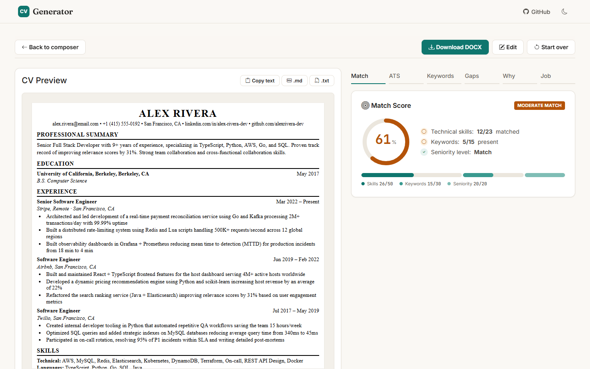
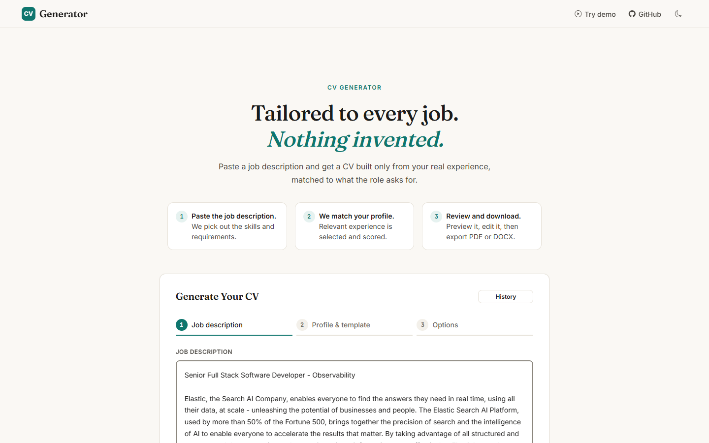
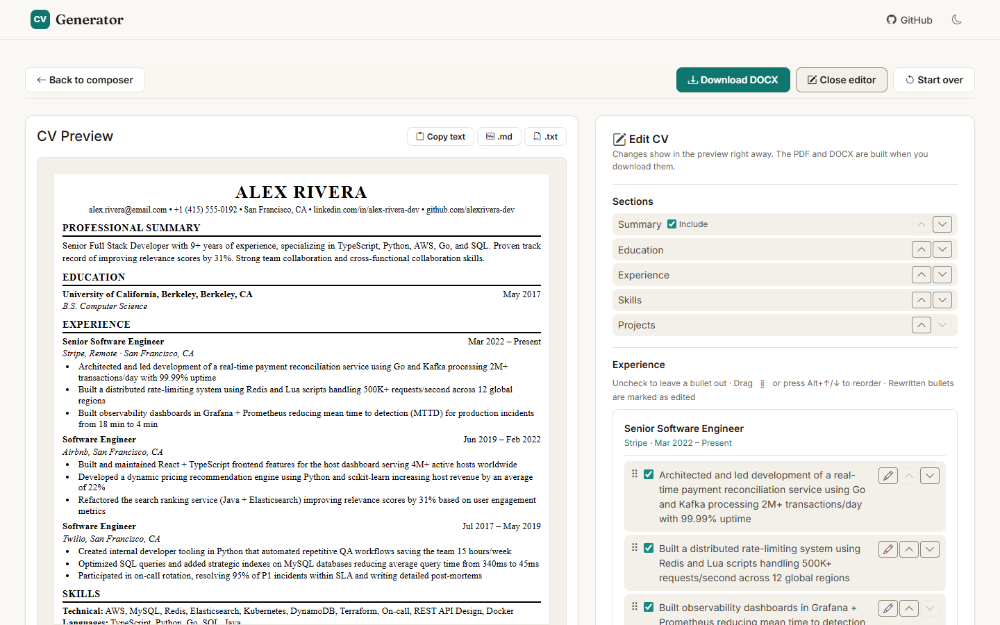
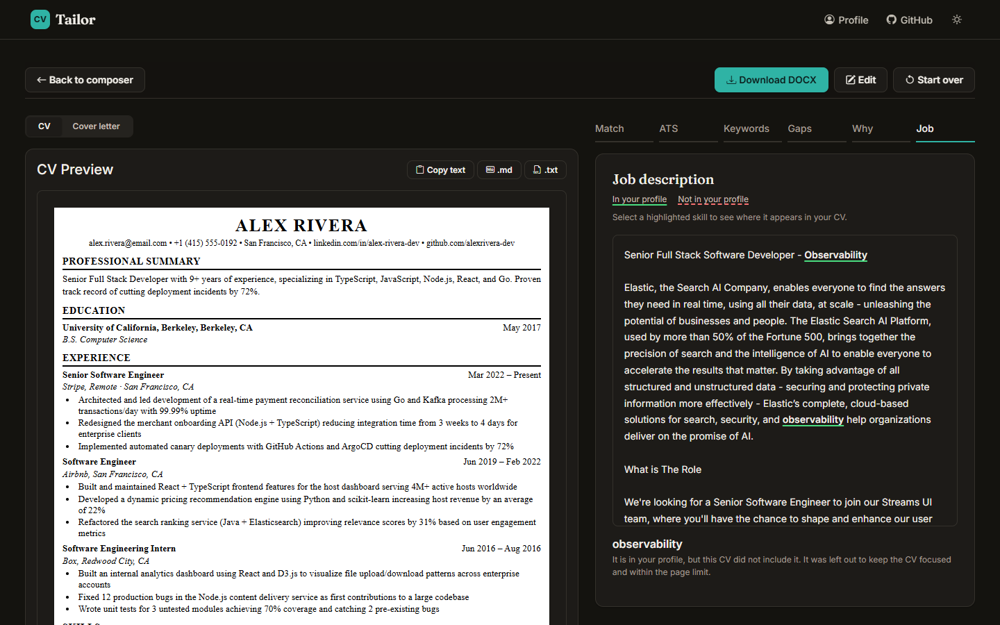
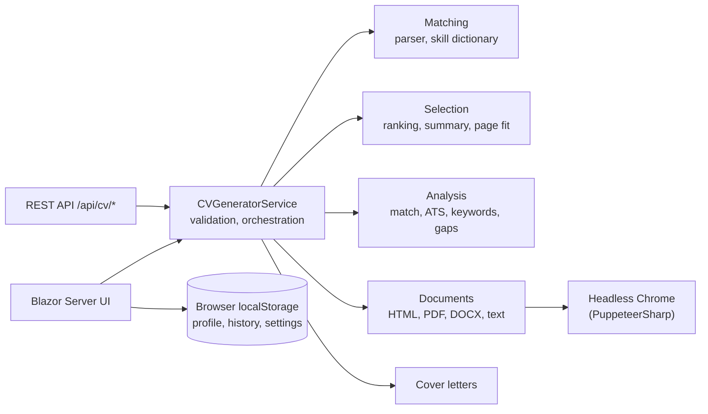

# ER CV Generator

[](https://github.com/EzequielRindello/er-cv-generator/actions/workflows/ci.yml)
[](features.md#test-10-coverage)
[](https://dotnet.microsoft.com/)

**Tailored to every job. Nothing invented.** Paste a job description and get a CV built only from your real
experience: the app picks the roles, bullets, skills and projects that match the post, writes a summary from your own
profile, scores the result, explains every choice, and exports PDF, DOCX, Markdown or plain text, with a cover letter
if you want one.

It is a single ASP.NET Core 10 app (Blazor Server UI and REST API in one deploy) with no database and no account.
Your profile and history stay in your browser.



> Live demo: coming with the first deploy (M5.2).

---

## What it does

- **Reads the job post.** A skill dictionary tuned on about 200 real posts (`Data/skills.json`) finds the skills,
  keywords, seniority and years asked for, and ignores ordinary English that looks like a skill ("the next
  generation" is not Next.js).
- **Selects, never writes.** Roles, bullets, skills and projects are ranked against the post and the best ones are
  kept. The summary is built from the profile's own title and years. Invariant tests check, for every profile and post,
  that every fact in the output exists in the profile.
- **Fits the page for real.** One or two pages, measured on the rendered PDF, not estimated.
- **Explains itself.** Why each item was chosen, a match score with its breakdown, missing skills, keyword coverage,
  an ATS check with fixes, and the job post with every skill highlighted and linked to where it appears in the CV.
- **Lets you finish it.** Edit the CV with a live preview: leave bullets out, rewrite or reorder them, move sections.
  Five templates, six accents, four font pairings, English or Spanish headings.
- **Tracks applications.** The last 50 CVs stay in your browser with their status, company and notes.

| Compose | Edit with a live preview | The post, highlighted (dark mode) |
|---|---|---|
|  |  |  |

---

## How matching works

1. **Parse.** `JobDescriptionParser` finds the dictionary skills (with aliases such as `k8s` for Kubernetes), the
   keywords, the seniority (from the title, or from the wording when the title names no level) and "N years of X"
   requirements.
2. **Score the match.** Skills count 50%, keywords 30% and seniority 20%. Under 40% the CV is flagged as a weak fit.
3. **Rank.** `RelevanceScorer` scores each role by matching skills, keywords, recency and seniority; `CVSelector`
   keeps the top roles and, inside each, the bullets with the most matching skills, metrics and strong verbs.
4. **Fit.** The selection starts from a character estimate, then the PDF is rendered and trimmed until its page count
   fits.
5. **Analyze.** Keywords, ATS rules and the highlighted post are computed on the final CV, so what you see is what
   you download.

Every weight and threshold is a named constant. There is no model in the loop: the same input gives the same CV.

---

## Architecture



The UI calls the service in-process; the API serves other clients. The domain lives in `ErCv.Web/Features/<Name>/`,
one folder per feature. [`PROJECT_OVERVIEW.md`](PROJECT_OVERVIEW.md) has the request flow, the project structure,
the data shapes and the design decisions; [`CLAUDE.md`](CLAUDE.md) has the coding conventions.

---

## Testing strategy

About 14,800 tests, most of them run over every profile and job post (hand-written cases plus one real post per role
family from the corpus).

| Layer | What it proves |
|---|---|
| Unit | each parser, scorer, selector and renderer on its own |
| Invariants | the product promise: nothing invented, order and limits respected |
| Documents | valid DOCX, PDF text and page count for every template |
| API | endpoints, validation, limits, sessions, rate limit |
| Snapshots | the generated CV and every score, as approved JSON: a scoring change is a diff to review |
| Components | bUnit tests of the editor, selectors, score cards and history |
| Browser | Playwright: the whole flow, downloads, editing, mobile widths, axe accessibility scans in light and dark |

CI runs everything on each push and PR, with line coverage of the domain and service (the job fails under 95%), plus
the browser tests and the Docker build.

```
dotnet test ErCv.Tests --filter "Category=Component|Category=Unit"   # seconds
dotnet test ErCv.Tests --filter "Category!=E2E"                      # the full suite, about 7 minutes (PDF page counts)
dotnet test ErCv.Tests --filter Category=Snapshot                    # approve a change with ERCV_SNAPSHOTS=approve
dotnet test ErCv.E2E                                                 # browser tests, uses an installed Chrome or Edge
```

The README screenshots come from the running app:
`ERCV_SCREENSHOTS=docs/screenshots dotnet test ErCv.E2E --filter Category=Screenshots`.

---

## Run it

```
dotnet run --project ErCv.Web          # http://localhost:5000, or set PORT
```

PDF export needs Chrome: set `PUPPETEER_EXECUTABLE_PATH` to an installed Chrome, or PuppeteerSharp downloads one on
first use. With Docker (the image Render builds, Chrome included):

```
docker build -t er-cv-generator .
docker run --rm -m 512m -e PORT=10000 -p 10000:10000 er-cv-generator
```

In Development the OpenAPI document is at `/openapi/v1.json` and its reference page at `/scalar`.

**Deploy:** one Docker web service on Render, defined in `render.yaml`, health check at `/api/cv/health`. The first
public deploy is milestone M5.2.

**Your own profile:** open *My profile*, start from a sample or import a JSON file, and save it. It stays in your
browser.

---

## Job-post corpus

`corpus/` holds real software job posts from the public Greenhouse, Lever, Ashby and Workable job-board APIs, dated
and linked to the original. They feed the samples in the UI, the tests and `corpus/report.md` (skill trends, parser
gaps). A refresh is run by hand and reviewed as a PR:

```
dotnet run --project ErCv.Collector -- refresh | report | samples | check
```

Sources, terms and how to remove a post: [`corpus/README.md`](corpus/README.md).

---

## Privacy

No account, no database, no analytics. Your profile, history and settings stay in your browser; the server holds a
CV in memory only while it builds it. The details are on the app's Privacy page (`/privacy`).

---

## Roadmap and version

Current version: **2.0.6** (M5 Polish & presentation). Each milestone ships as one version; the roadmap, the findings and the
reasoning behind each decision are in [`features.md`](features.md).
